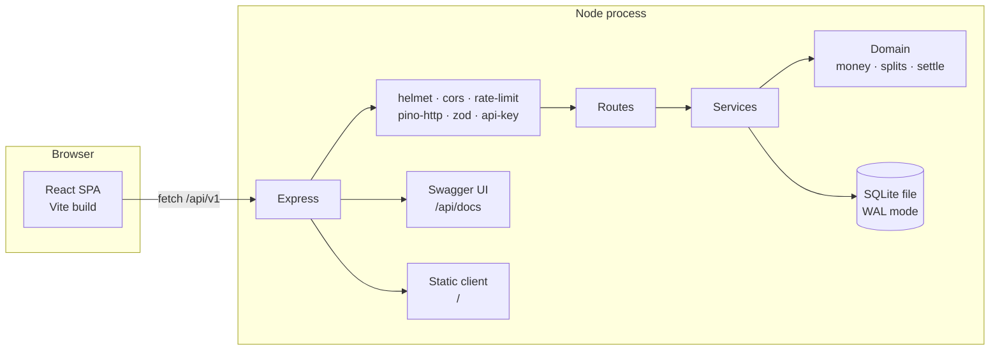

# System design

## Goals

1. **Correct money.** Splits must always add up; balances must never drift.
2. **Trivial to run and demo.** `npm install && npm run dev`, or one container. No external services.
3. **Production hygiene without over-engineering.** Validation, logging, security headers, tests, health checks, graceful shutdown.
4. **Clear upgrade path.** Nothing in the design blocks moving to Postgres, auth, or multiple instances later.

## High-level architecture



A single deployable unit serves both the API and the built UI from the same origin, which removes CORS and cookie headaches and keeps deployment to "run this container with a volume".

## Layering

| Layer | Folder | Responsibility | Depends on |
| --- | --- | --- | --- |
| HTTP | `server/src/routes` | Parse/validate requests (zod), call a service, shape status codes | services, middleware |
| Services | `server/src/services` | Use-cases: transactions, membership rules, persistence | db, domain |
| Domain | `server/src/domain` | Pure functions: cent conversion, split allocation, debt simplification. No I/O, 100 % unit-testable | nothing |
| DB | `server/src/db` | Connection, pragmas, migrations, nested transactions | node:sqlite |

Keeping the domain pure means the trickiest logic (rounding, simplification) is tested in isolation and could be reused by the client or a worker.

## Key design decisions

### 1. Ledger + derived balances (not stored balances)

The original app stored an `owes` / `owedBy` document per user and mutated it on every expense and repayment. That design had no notion of *who paid*, double-counted shares, and could drift whenever an update failed half-way.

Now **expenses + splits + settlements form an append-only ledger**, and balances are computed by aggregation on read:

```
net(user) = Σ paid − Σ own share + Σ settlements paid out − Σ settlements received
```

Consequences:
- Editing or deleting an expense is just a row update; balances are automatically correct.
- No cache invalidation problem; no "balance repair" job.
- Cost is a few indexed `SUM` queries per read, trivial at the group sizes this app targets (tens of members, thousands of expenses). If a group ever grew into millions of rows you could add a materialised per-group summary table, refreshed in the same transaction.

### 2. Integer cents and largest-remainder allocation

All amounts are stored as integer minor units. Splitting 100.00 three ways yields `34, 33, 33` cents-exact rather than `33.333…`. The allocation uses the largest-remainder (Hamilton) method so every split sums exactly to the total and the result is deterministic (ties broken by participant order). The same algorithm is mirrored in the client for live previews, but the server result is authoritative.

### 3. Four split modes behind one interface

`computeSplits(type, totalCents, participants)` normalises *equal / exact / percent / shares* into `{userId, amountCents, shareValue}` rows. Adding a new mode (e.g. "itemised") touches one function and one enum.

### 4. Simplified settle-up

`simplifyDebts(net)` greedily matches the largest debtor with the largest creditor, giving at most *n−1* transfers. Finding the true minimum number of transfers is NP-hard (subset-sum); the greedy approach is what Splitwise and friends ship and is optimal in the typical case. The raw pairwise view is still exposed for people who prefer to pay exactly the person they owe.

### 5. SQLite via `node:sqlite`

See [DATABASE.md](DATABASE.md) for the full reasoning. In short: relational data, strong transactions, single-file deployment, zero native build steps (the module is built into Node ≥ 22.13), and a straightforward migration to Postgres because the SQL is plain and the DB layer is a thin module.

### 6. Synchronous DB calls

`node:sqlite` is synchronous. For a local file database this is a feature: no connection pool, no await-chains, and transactions are plain function calls (`transaction(() => {...})` with SAVEPOINT nesting). Queries run in microseconds, so the event loop is not meaningfully blocked at this scale. If heavy analytical queries were added they would move to a worker thread.

### 7. Soft deletes for ledger rows

Expenses and settlements get a `deleted_at` timestamp instead of being removed, so the activity feed stays honest ("Ben deleted Taxi €38") and mistakes are recoverable. Groups are hard-deleted (with cascade) after an explicit confirmation because that is the user's intent.

### 8. Validation at the edge, invariants in the service

zod schemas reject malformed input with a `400 VALIDATION_ERROR` and a field-level `details` array. Business rules (payer must be a member, exact splits must add up, cannot remove a member with a balance) are enforced in services and surface as `422 UNPROCESSABLE` / `409 CONFLICT`. Error responses share one shape: `{ error: { code, message, details? } }`.

### 9. Identity model: "Viewing as" instead of accounts

The brief is a bill-splitting demo, so the app deliberately has no sign-up flow. Every screen is rendered from the perspective of the person selected in the header, stored in `localStorage`. This keeps the demo friction-free while exercising the same per-user computations a logged-in app would need. An optional shared `API_KEY` protects deployed instances.

**Upgrade path:** add a `sessions` table or a JWT middleware, attach `req.user`, and replace the header selector with the authenticated user. Services already take `userId` explicitly, so none of them change.

## Cross-cutting concerns

| Concern | Implementation |
| --- | --- |
| Config | `config.js` parses and validates env with zod; the process refuses to start with bad config |
| Logging | pino JSON logs with request IDs (`x-request-id` honoured), secrets redacted |
| Security | Helmet CSP, CORS allow-list, per-IP rate limit, 256 kB body cap, optional API key, no `x-powered-by`, non-root Docker user |
| Health | `GET /api/health` executes a DB round-trip; Docker `HEALTHCHECK` wired to it |
| Shutdown | SIGINT/SIGTERM drain HTTP then close the DB; 10 s hard timeout |
| Docs | OpenAPI 3 spec served at `/api/openapi.json`, Swagger UI at `/api/docs` |
| Tests | vitest: pure domain tests + supertest API tests against an in-memory DB |

## Scaling path

| Stage | Change |
| --- | --- |
| Single VM / container (now) | SQLite + volume; nightly backup with `sqlite3 .backup` or Litestream replication |
| Multiple API instances | Swap `db/connection.js` for a Postgres driver (schema is plain SQL); keep services unchanged |
| Real users | Add auth middleware, per-user authorisation checks in services (`assertMember` already exists) |
| Heavy read load | Materialise group balance summary; add HTTP caching (`ETag` already emitted by Express) |
| Notifications / integrations | Emit domain events from services (expense.created, settlement.created) to a queue |

## What was deliberately left out

- Multi-currency conversion inside a group (each group has one currency; FX would need rate snapshots per expense).
- Recurring expenses, receipts/attachments, comments, push notifications.
- Account system / OAuth — see "Identity model" above.
