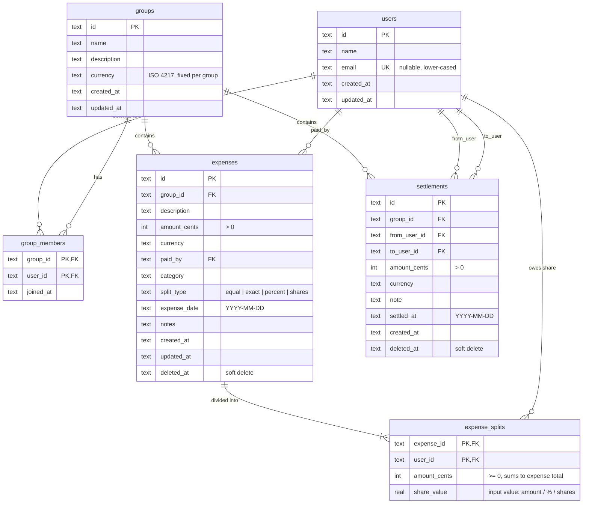

# Database design

## Why SQLite (and why not MongoDB any more)

The original version used MongoDB with a denormalised `Balance` document per user. For a bill splitter that was the wrong shape:

| Requirement | Document store experience | Relational experience |
| --- | --- | --- |
| Many-to-many: users ↔ groups ↔ expenses ↔ splits | Embedded arrays or manual references, no joins, no FK integrity | Natural join tables with foreign keys and cascades |
| Balances must equal the ledger | Had to be *maintained* by application code on every write → drift bugs | *Derived* by `SUM` + `GROUP BY` → always consistent |
| Multi-row atomicity (expense + N splits) | Needs replica-set transactions | Plain `BEGIN … COMMIT` |
| Simple deploy & demo | Separate database server or Atlas account | A file next to the app |

SQLite was chosen over Postgres for the default because:

1. **Zero infrastructure.** `npm start` works on a laptop, in CI, and in a 50 MB container. Nothing to provision for a demo.
2. **Built into Node ≥ 22.13** (`node:sqlite`): no native compilation, no `node-gyp`, no prebuilt-binary downloads that fail behind corporate proxies.
3. **Genuinely production-grade for this workload.** WAL mode gives concurrent readers with one writer; a bill-splitting app writes a handful of rows per minute, not per millisecond. Fly.io, Litestream, Turso, and many SaaS back-offices run SQLite in production.
4. **Portable SQL.** The schema uses only standard types and constraints, so moving to Postgres is a driver swap (see bottom).

Trade-offs accepted: a single writer process (horizontal API scaling requires Postgres), and backups are file-based (trivial with `sqlite3 .backup` or Litestream).

## Entity-relationship diagram



## Modelling decisions

### Money as integer cents
`amount_cents INTEGER` everywhere. Floats are never persisted. Conversion happens once at the API boundary (`toCents` / `fromCents`), and `toCents` rejects sub-cent input.

### The ledger is the source of truth
There is **no balances table**. Balances are a view over `expenses`, `expense_splits` and `settlements`:

```sql
-- net position of every member of a group (positive = is owed)
SELECT gm.user_id,
       COALESCE(SUM(CASE WHEN e.paid_by = gm.user_id THEN e.amount_cents END), 0)       -- paid
     - COALESCE((SELECT SUM(s.amount_cents) FROM expense_splits s
                 JOIN expenses e2 ON e2.id = s.expense_id
                 WHERE e2.group_id = gm.group_id AND s.user_id = gm.user_id
                   AND e2.deleted_at IS NULL), 0)                                        -- share
     + settlements_out - settlements_in                                                  -- (see service)
FROM group_members gm ...
```

The actual implementation lives in `server/src/services/balances.service.js` and uses correlated sub-selects per member; every one of them hits an index.

### Pairwise debts
For each expense, every split row where `user_id ≠ paid_by` is a debt *split.user → payer*. A settlement *from → to* is modelled as a debt in the opposite direction (*to → from*), so netting both directions per pair gives the outstanding amount. This is computed with two `GROUP BY` queries and a small in-memory fold.

### Soft deletes
`deleted_at` on `expenses` and `settlements`. All balance queries filter `deleted_at IS NULL`; the activity feed shows deleted rows flagged. `expense_splits` are hard-deleted and re-inserted when an expense is edited because they are a pure function of the expense.

### Identifiers and timestamps
UUID v4 strings (`crypto.randomUUID()`) so IDs are safe to expose and remain valid if data is ever merged or moved to a distributed database. Timestamps are ISO-8601 text in UTC; dates that users pick (`expense_date`, `settled_at`) are `YYYY-MM-DD` strings with no timezone to avoid off-by-one-day bugs.

### Constraints that encode business rules
- `CHECK (amount_cents > 0)` on expenses and settlements; `>= 0` on splits (a participant may legitimately owe 0 in a percent split).
- `CHECK (from_user_id <> to_user_id)` on settlements.
- `group_members` composite PK prevents duplicate membership; `ON DELETE CASCADE` from `groups` cleans everything up; `ON DELETE RESTRICT` from `users` protects history (users can only be deleted when they are in no group).

### Indexes
| Index | Serves |
| --- | --- |
| `idx_expenses_group_date (group_id, expense_date DESC, created_at DESC)` | Expense list pagination |
| `idx_expenses_paid_by` | "paid" sums |
| `idx_expense_splits_user` | "share" sums |
| `idx_settlements_group (group_id, settled_at DESC)` | Settlement list, settlement sums |
| `idx_group_members_user` | "groups for a user" |

## Connection settings

```sql
PRAGMA journal_mode = WAL;     -- readers don't block the writer
PRAGMA synchronous = NORMAL;   -- durable at checkpoint; safe with WAL
PRAGMA foreign_keys = ON;      -- off by default in SQLite!
PRAGMA busy_timeout = 5000;    -- wait instead of SQLITE_BUSY
```

## Migrations

`server/src/db/migrations.js` holds an ordered array of `{ version, name, sql }`. On boot the app reads `PRAGMA user_version`, applies every newer migration inside a transaction, and bumps the version. To change the schema, append a new entry — never edit an applied one.

## Backups

- Hot backup: `sqlite3 data/expensesplit.db ".backup backup.db"` (safe while the app runs).
- Continuous replication to S3-compatible storage: [Litestream](https://litestream.io) as a sidecar.
- Docker: the DB lives in the `expensesplit-data` volume; `docker run --rm -v expensesplit-data:/data -v $PWD:/out alpine cp /data/expensesplit.db /out/`.

## Moving to PostgreSQL

When you need multiple API instances or managed HA:

1. Replace `server/src/db/connection.js` with a `pg` pool exposing the same `prepare().get/all/run` surface (or switch services to `await`), and change `transaction()` to `BEGIN/COMMIT` on a checked-out client.
2. Schema changes: `TEXT` → `UUID`/`TIMESTAMPTZ`, `INTEGER` → `BIGINT`, drop the pragmas. Everything else in `migrations.js` is valid Postgres.
3. Correlated `SUM` sub-selects and `UNION ALL` in the activity query run unchanged.

Services and routes do not need to change — they only call the DB module.
