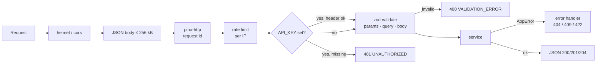
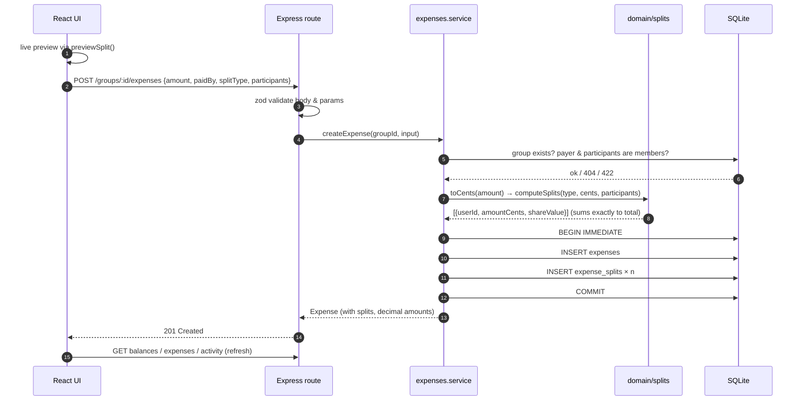
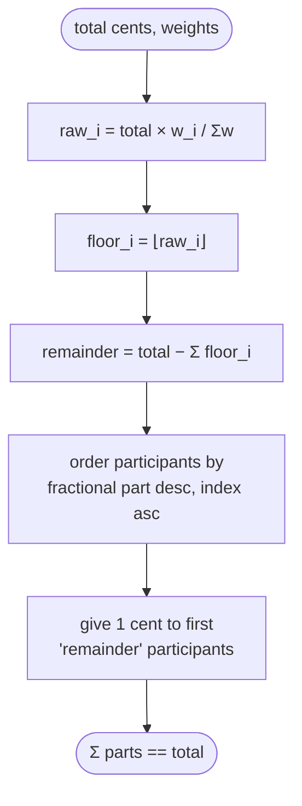
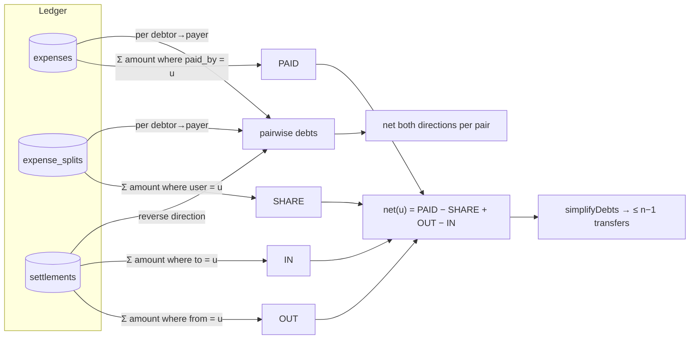
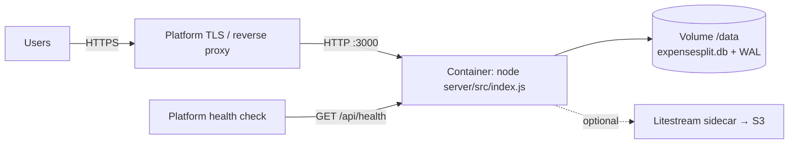

# Flows

All diagrams are Mermaid and render on GitHub, in VS Code/Cursor previews and at [mermaid.live](https://mermaid.live).

## 1. End-to-end user journey

```mermaid
flowchart TD
  A([Open app]) --> B{Any people / groups?}
  B -- no --> C[Load demo data<br/>or add people]
  B -- yes --> D[Pick "Viewing as"]
  C --> D
  D --> E[Create / open a group]
  E --> F[Add expense<br/>payer · amount · split mode]
  F --> G[Server validates & computes cent-exact splits]
  G --> H[Balances tab<br/>net · pairwise · simplified]
  H --> I{Settle up?}
  I -- record payment --> J[Settlement stored]
  J --> H
  I -- later --> K[Activity feed<br/>audit trail, undo]
```

## 2. Request pipeline



## 3. Adding an expense (sequence)



## 4. Split allocation (largest remainder)



Example: 100.00 split equally 3 ways → raw 33.33̅ each → floors 33/33/33 → remainder 1 → `34, 33, 33`.

## 5. How balances are derived



## 6. Settle-up suggestion algorithm

```mermaid
flowchart TD
  A([net per member]) --> B[creditors: net > 0, sorted desc]
  A --> C[debtors: net < 0, sorted desc by |net|]
  B & C --> D{both lists non-empty?}
  D -- no --> Z([done])
  D -- yes --> E[x = min(top debtor, top creditor)]
  E --> F[emit transfer debtor → creditor, x]
  F --> G[subtract x from both;<br/>pop whichever hits 0]
  G --> D
```

## 7. Deployment topology


